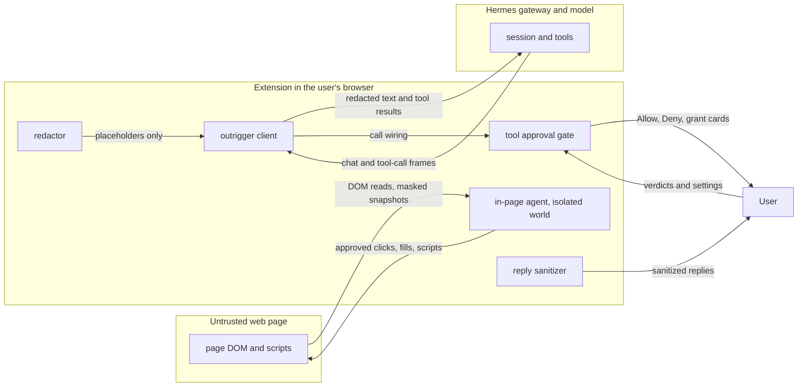
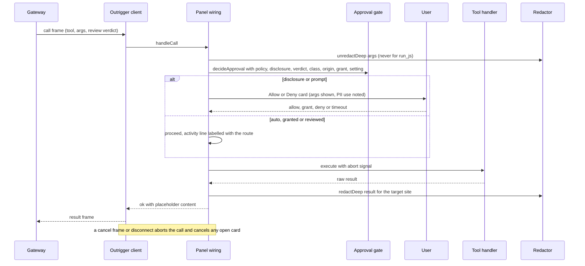
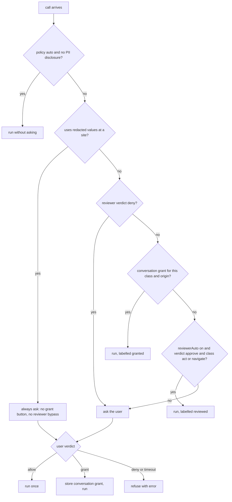
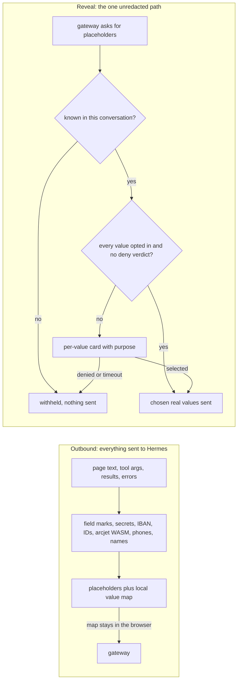
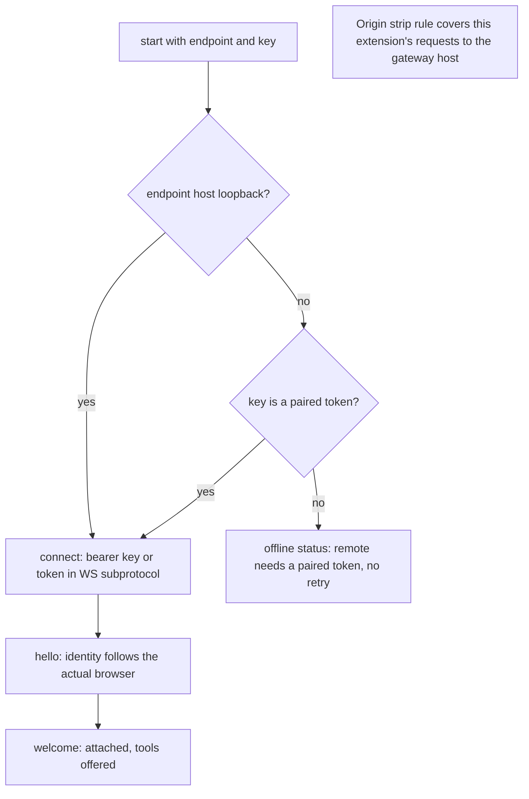

# Hermes Sidebar audit map

The auditor's hub for this extension: one shared codebase (`shared/`) with two thin
browser adapters (`chrome/`, `firefox/`). It maps entry points → trust boundaries →
controls → sinks, and names the security-sensitive units. Every `file:line` anchor is
checked by CI (`docs-audit`): code that moves breaks its anchors, so this map must be
updated in the same PR. Diagrams are claims too — each node/edge was verified against
the code in the claims pass.

Frozen evidence: `shared/docs/security-review.md` is the dated static review plus the
runtime-verification record (Firefox 158, Chromium 159). It is exempt from the overclaim
gate as historical evidence; this hub and the README are the living surfaces.

Tests: `node --test tests/tool-gate.test.mjs tests/outrigger-policy.test.mjs` — the
approval decision is pinned against the pre-extraction logic over the full input matrix.

## Trust boundaries

Crossings that matter: page → extension is read-only DOM access in the isolated world
(refs stay out of the page's reach); extension → page happens only through approved
tool handlers; gateway → extension frames are untrusted input (model output is
sanitized before the DOM, tool calls are approval-gated); extension → gateway carries
placeholders, never the redaction map — the reveal path is the one deliberate exception.

## Entry points → controls → sinks

| Entry | Boundary | Control (invariant) | Sink | Code |
|-------|----------|---------------------|------|------|
| WS `call` frame | gateway → extension | unknown tools refused; args unredacted in-browser except `run_js`; approval gate before execution | tool handler | shared/outrigger.js:160, shared/panel.js:363-372 |
| Approval decision | model → user authority | disclosure always asks; reviewer deny always asks; reviewer auto-approve limited to act/navigate classes and the reviewerAuto setting | card or auto-run | shared/tool-gate.js:57-65 |
| Grant offer | user → conversation policy | no grant button for flagged calls, missing origin, or cross-site classes (reveal, personal) | conversation grants | shared/tool-gate.js:68-70, shared/panel.js:262 |
| `reveal` call | gateway → real PII | per-value card; auto-allow only when every value was opted in and no deny verdict; the one unredacted outbound path | real values to Hermes | shared/tool-gate.js:74-76, shared/panel.js:478-499 |
| Outbound text | browser → gateway | redact/redactDeep replace values with placeholders; the value map never leaves; redaction stays on for invalid URLs | placeholders | shared/redactor.js:140, shared/redactor.js:204, shared/redactor.js:116 |
| Reply rendering | model → DOM | raw HTML escaped; DOMPurify with link/image/checkbox hooks; parse failure falls back to escaped text | sanitized DOM | shared/markdown.js:32-55, shared/panel.js:193 |
| Media frames | gateway → DOM | inline data becomes a blob URL; remote media must be http(s); images no-referrer; file links noopener noreferrer | img / anchor | shared/panel.js:668 |
| Page snapshots | page → extension | refs in WeakRef/WeakMap in the isolated world; password values masked; fields PII-tagged by semantics | snapshot text | shared/page-agent.js:14-15, shared/page-agent.js:136 |
| `fetch_as_user` | extension → site | same-origin check plus final-URL origin re-check after redirects | response body (redacted afterwards) | shared/page-agent.js:299-306 |
| Tool execution | extension → tabs/page | targetTab refuses restricted pages; close_tab only tabs Hermes opened; open_url http(s) only; screenshot refuses restricted pages | tabs / scripting / debugger | shared/browser-tools.js:107, shared/browser-tools.js:210, shared/browser-tools.js:241, shared/browser-tools.js:217 |
| WS connect | extension → gateway | API key accepted only for loopback endpoints; remote requires a paired token; refusal is loud and does not retry | WebSocket | shared/outrigger.js:28-33, shared/outrigger.js:94-99, shared/options.js:86 |
| Gateway requests | extension → gateway | Origin removed only for this extension's requests to the configured gateway host; rule follows the endpoint setting | HTTP / WS handshake | chrome/platform.js:116, firefox/platform.js:98, firefox/platform.js:166, shared/background-common.js:13-20 |
| Conversation memory | extension → storage | transcript, grants and redaction map live in chrome.storage.session (memory only, cleared on browser close) | session storage | shared/panel.js:704, shared/panel.js:712 |

## Key workflows

### Tool call round trip

### Approval decision (tool-gate.js decideApproval)

### Redaction and reveal

### Connection and credential policy

## Security-sensitive units

Each carries an inline `Audit: see AUDIT.md` pointer; CI checks the pointers exist.

| Unit | Responsibility | Section |
|------|----------------|---------|
| shared/tool-gate.js | approval vocabulary + pure decisions (grants, reviewer limits, disclosure) | #tool-approval-gate |
| shared/panel.js | wiring: handleCall, reveal, media, memory, send-path redaction | #tool-call-wiring |
| shared/browser-tools.js | tool declarations, execution guards, handlers | #tool-handlers |
| shared/redactor.js | PII detection, placeholders, value map, state export | #redaction |
| shared/markdown.js | model output → sanitized DOM | #reply-sanitization |
| shared/page-agent.js | isolated-world refs, masking, same-origin fetch | #in-page-agent |
| shared/outrigger.js | WS client, credential policy, client identity | #gateway-connection, #credential-policy |
| shared/options.js | settings storage, test-connection policy parity | #credential-policy, #settings-storage |
| chrome/platform.js | CDP tools, DNR Origin strip, restricted pages | #origin-strip, #browser-adapters |
| firefox/platform.js | async bridge, webRequest Origin strip, dev hook | #origin-strip, #browser-adapters |
| shared/background-common.js | Origin rule lifecycle, context menu | #origin-strip, #context-menu |
| shared/api-shim.js | Firefox chrome.* promise adapter (load-order critical) | #api-shim |

## Tool approval gate

The authorization core, extracted from panel.js behavior-preservingly (pinned by
tests/tool-gate.test.mjs, including a 1536-combination matrix against the pre-extraction
branching). Vocabulary: TOOL_CLASS (shared/tool-gate.js:26), NO_GRANT_CLASSES
(shared/tool-gate.js:31), REVIEWER_CLASSES (shared/tool-gate.js:34), DISCLOSING_TOOLS
(shared/tool-gate.js:37). Decisions: decideApproval (shared/tool-gate.js:57),
canOfferGrant (shared/tool-gate.js:68), canAutoReveal (shared/tool-gate.js:74).
Grants are conversation-scoped (`class|origin`, shared/tool-gate.js:40) and cleared when
a new conversation starts (shared/panel.js:520).

## Tool call wiring

handleCall (shared/panel.js:363) is the only route from a gateway call frame to a
handler. Invariants: `run_js` arguments are never unredacted (shared/panel.js:371-373) —
arbitrary code with real values could send them anywhere; every handler result and error
is redacted for the target site before it leaves (shared/panel.js:412, shared/panel.js:419);
binary image payloads bypass the text redactor by design (screenshots are not redacted —
stated in the tool description, shared/browser-tools.js:74). revealCall
(shared/panel.js:478) is the one deliberate unredacted path, per-value approved
(revealCard, shared/panel.js:424); revealed values are marked shared so later cards can
say so. Media (renderMedia, shared/panel.js:668) accepts inline base64 as blob: URLs or
http(s) remotes only, with no-referrer images and noopener noreferrer file links.

## Tool handlers

Execution guards in shared/browser-tools.js: targetTab (shared/browser-tools.js:107)
refuses restricted/browser pages for every tab-targeted tool; close_tab
(shared/browser-tools.js:210) only closes tabs in hermesTabs (shared/browser-tools.js:105),
i.e. tabs Hermes opened with open_url; open_url (shared/browser-tools.js:241) accepts
http(s) only; screenshot (shared/browser-tools.js:217) refuses restricted pages.
run_js (shared/browser-tools.js:166) and dev_watch go through the platform adapter
(debugger on Chrome, executeScript bridge on Firefox) and are approval-gated upstream.

## Redaction

redactor.js replaces values with stable placeholders (⟦TYPE_n⟧) before anything leaves
the browser: redact (shared/redactor.js:140), redactDeep (shared/redactor.js:204).
Detectors: page-agent field marks, secrets (shared/redactor.js:65), IBAN with mod-97
validation, NI/SSN, arcjet WASM (email/phone/card/IP), national phone formats
(shared/redactor.js:81), compromise names/places. The value map (byPh) is never sent;
unredactDeep (shared/redactor.js:217) runs only in-browser for tool args and local
display. activeFor (shared/redactor.js:116) keeps redaction on for invalid/empty URLs;
only an explicitly skipped site disables it. State export/import
(shared/redactor.js:98-102) feeds chrome.storage.session only. Known gap: an arcjet WASM
failure is caught and warned while other detectors continue — the security review
recommends a loud self-test.

## Reply sanitization

renderMarkdown (shared/markdown.js:55) parses GFM with raw HTML escaped at the renderer
(shared/markdown.js:28), then DOMPurify with afterSanitizeAttributes hooks
(shared/markdown.js:32): links https/mailto only with noopener noreferrer, images https
only with no-referrer, inputs only disabled task-list checkboxes; FORBID_TAGS/ATTR
(shared/markdown.js:51) drop style/form/iframe/svg/math/media and inline styles. Parse or
sanitize failure falls back to fully escaped text. renderInto (shared/panel.js:193)
rehydrates placeholders for the user's eyes only after sanitization.

## In-page agent

page-agent.js runs in the extension's isolated world on untrusted pages. Refs live in
WeakRef/WeakMap (shared/page-agent.js:14-15) — the page has no access to read, list or
forge them; a ref goes stale when its element is removed. Password values are masked in
snapshots (shared/page-agent.js:136); fields are tagged by autocomplete/type semantics
for the redactor. fetchAsUser (shared/page-agent.js:299) checks the request origin against
the page AND re-checks the final response URL after redirects (shared/page-agent.js:306).

## Gateway connection

outrigger.js speaks protocol v1/v2 over WebSocket. Call frames dispatch through _runCall
(shared/outrigger.js:179) with an AbortController per call; cancel frames and disconnects
abort in-flight calls and cancel open cards. Client identity (kind/label) follows the
actual browser (shared/outrigger.js:19-22). The gateway is trusted once attached; replies
are still sanitized and tool calls still gated — attachment is not approval.

## Credential policy

Decided D1 option c (see the security review): the owner API key is accepted only for
loopback endpoints — isLoopbackEndpoint (shared/outrigger.js:28) recognizes 127.0.0.1,
localhost and ::1. A non-loopback endpoint requires a paired token; _connect
(shared/outrigger.js:94-99) refuses before creating a socket, reports a clear offline
status and does not retry (a settings change calls start again). The settings
test-connection enforces the same rule (testWS, shared/options.js:86). The key travels in
the WS subprotocol because the browser WS API offers no header field; on loopback it never leaves
the machine. Tokens are scoped and revocable server-side (hermes-outrigger).

## Origin strip

The gateway rejects unknown Origins, so the extension removes Origin on its OWN requests
to the configured gateway host — never on page requests. Chrome: a declarativeNetRequest
dynamic rule scoped by initiatorDomains and host regex (syncOriginRule,
chrome/platform.js:116). Firefox: a blocking webRequest listener that checks the request
host and that originUrl/documentUrl belong to the extension (stripOrigin,
firefox/platform.js:98; registration firefox/platform.js:166). The rule is registered at
startup and re-registered on endpoint changes (shared/background-common.js:13-20).
Runtime-verified on both browsers including the WS handshake (security review, check 4/5).

## Browser adapters

chrome/platform.js: CDP runJs (chrome/platform.js:43) and devWatch
(chrome/platform.js:72) attach the debugger to the target tab only; isRestricted
(chrome/platform.js:31) marks pages that must never be scripted or captured.
firefox/platform.js: the async bridge (firefox/platform.js:72) accepts answers only from
its own injected code, filtered by a per-call id and sender tab; dev_watch uses a
main-world hook (firefox/platform.js:31) whose buffer a hostile page can spoof — a
documented debugging-aid limit, no privilege boundary crossed; strict-CSP pages may block
the hook (console capture empty, network capture unaffected).

## API shim

Firefox's chrome.* is callback-only; the shared code awaits promises. api-shim.js adapts
chrome over browser.* where the latter exists, and is a no-op on Chrome. It must load
first in every context (Firefox background.scripts; first script tag in panel.html,
options.html, notebook.html). A broken or missing shim silently disables every
promise-style security path — the F2 regression in the security review.

## Context menu

The right-click "Ask Hermes" items (shared/background-common.js:23) open the panel and
hand it the selection/link/image/page via chrome.storage.session (pendingAsk), consumed
once within 60 s and only by the matching window (shared/panel.js:732). No page
content is sent until the user presses send (and redaction runs then).

## Settings storage

Settings (endpoint, key, tool toggles, redaction categories/skip) live in
chrome.storage.local, written by options.js save (shared/options.js:52). Conversation
state — transcript, grants, redaction map — lives only in chrome.storage.session
(save, shared/panel.js:704; restore, shared/panel.js:712): memory, cleared when the
browser closes. The key is shown masked in the UI with an explicit reveal toggle.

## Invariants and failure contracts

- A call that puts redacted values into a site always asks — no grant, no reviewer bypass.
- A reviewer deny verdict always reaches the user; grants do not override it.
- Code execution (run_js) is never reviewer-auto-approved; its args are never unredacted.
- Grants are conversation-scoped and never offered for reveal/personal classes.
- The redaction map never leaves the browser; reveal is per-value approved.
- Screenshots are not redacted (binary payload; stated in the tool description).
- Model text reaches the DOM only through the sanitizer; failure falls back to escaped text.
- Origin removal is scoped to the extension's own gateway requests, both browsers.
- Policy refusals (credential policy, unknown tool, restricted page, non-Hermes tab close)
  return loud errors; the arcjet WASM catch is the one known warn-and-continue gap.

## Verification

- Unit: `node --test tests/tool-gate.test.mjs tests/outrigger-policy.test.mjs` (24 tests;
  the decision matrix compares the extracted gate against the pre-extraction branching).
- Runtime: both browsers load-tested headlessly; record in shared/docs/security-review.md
  (Runtime verification): redaction/WASM, page-agent persistence and refs, the async
  bridge, dev_watch, Origin strip and the full WS handshake, Chrome side panel/CDP/tab
  groups/DNR.
- CI: `docs-audit` checks anchor freshness, hub pointers, mermaid rendering and overclaim
  words on the shipping surfaces; `test` runs the unit suite. Both are required checks.
