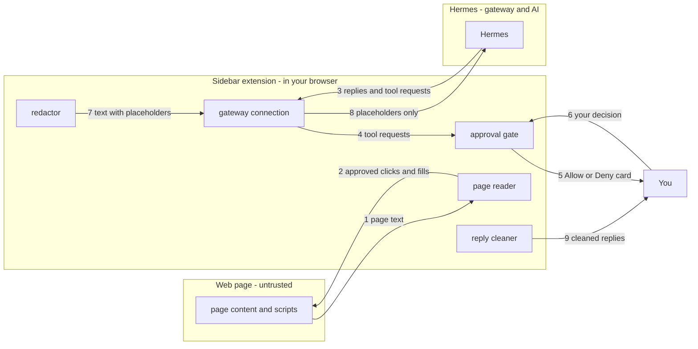
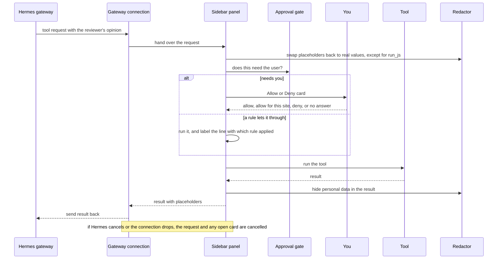
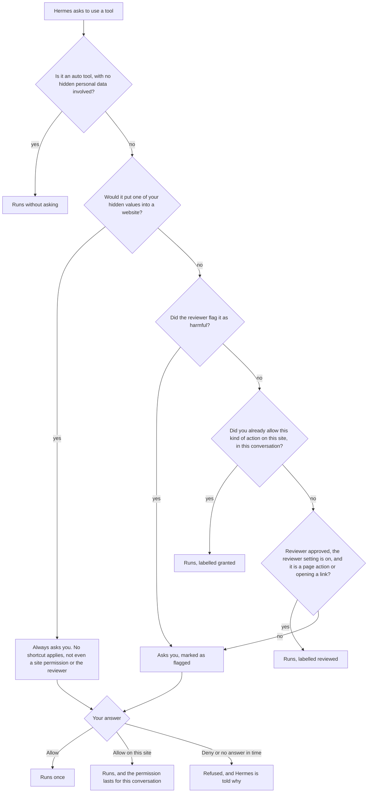
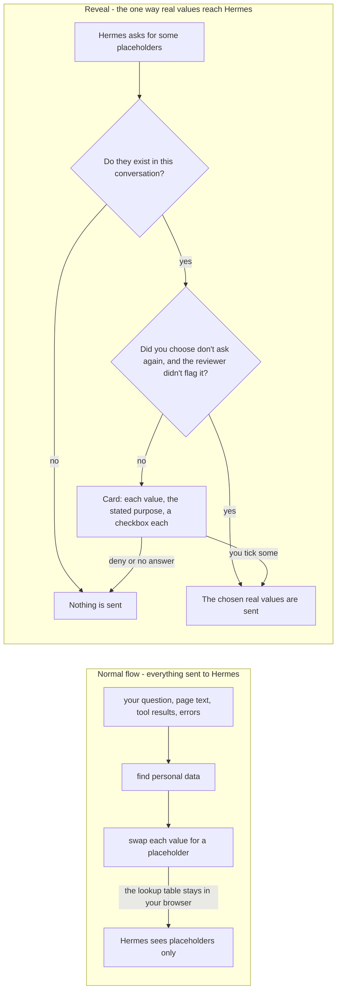
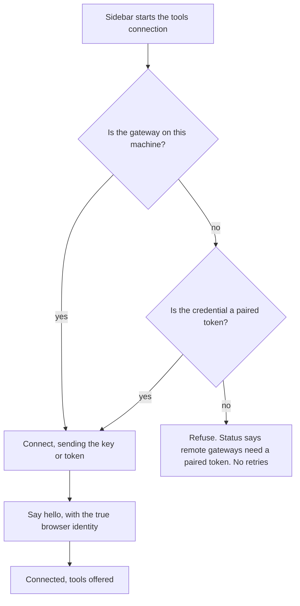

# Hermes Sidebar: security audit guide

This guide explains, in plain language, how the Hermes Sidebar extension handles your
browser, your personal data and your Hermes credentials: what can go wrong, what stands
in the way, and what risk is left over. It is written to be read top to bottom by a
person, not just searched by a tool.

How to read it:

- Each topic follows the same pattern: **what happens**, **what could go wrong**,
  **what protects you**, and **what's left** (the residual risk).
- Diagrams come with a short "how to read this diagram" note.
- Lines starting with **Code:** point at the exact source lines (`file:line`) for an
  auditor who wants to check a claim. You can skip them if you are reading for
  understanding. CI checks that every one of these still points at real code, so this
  guide can't silently drift away from the code.
- Words in *italics* are explained in the [glossary](#glossary) at the end.

The dated security review and the record of live browser testing (Firefox 158,
Chromium 159) are in `shared/docs/security-review.md`. That file is historical evidence;
this guide is the living explanation.

## The extension in one minute

The sidebar is a chat panel inside your browser. You ask Hermes (your AI agent, running
on your *gateway*) about the page you're reading. Hermes can also ask to use *browser
tools*: read a page, click a button, fill a form, open a link.

Three parties are involved, and they trust each other to different degrees:

1. **You and your browser.** You hold the final say over actions and over your
   personal data.
2. **Web pages.** Untrusted. Any page can contain hidden text written to trick an AI
   (*prompt injection*).
3. **Hermes (gateway + AI model).** Trusted to do useful work, but an AI can be
   confused or manipulated by what it reads, so its requests are checked.

The sidebar sits in the middle, and nearly all of its security work comes down to two
questions: **may Hermes do this?** and **may this data leave the browser?**

## The main risks at a glance

| # | Risk | Example | Main protection | What's left |
|---|------|---------|-----------------|-------------|
| 1 | Hermes takes an action you didn't want | A page hides the text "click Delete account"; Hermes reads it and tries | Actions need your Allow card, unless a rule lets them through ([approval gate](#tool-approval-gate)) | By default, Hermes's own AI reviewer can approve clicks, form fills and opening links **without showing you a card**. Reading tools never ask. |
| 2 | Your personal data reaches Hermes | Your email address is on the page Hermes reads | Personal data is swapped for *placeholders* before anything is sent ([redaction](#redaction)) | Detection is best effort; screenshots aren't redacted; sites on your skip list aren't redacted |
| 3 | Your personal data reaches a website | Hermes fills a form with your real phone number | Using a hidden value at a site always shows a card, and no rule can skip it | You can approve it, by design |
| 4 | Your Hermes key leaks | The key travels to a remote gateway over an unencrypted link | The tools connection refuses to send the key anywhere except your own machine ([credential policy](#credential-policy)) | **Open finding N1:** the plain chat path still sends the key to a remote gateway |
| 5 | A reply contains harmful code | The AI's reply includes a script tag or a booby-trapped link | Replies are cleaned before display ([reply sanitization](#reply-sanitization)) | Relies on the DOMPurify library being correct |
| 6 | A web page tampers with the extension | A page tries to forge or read the sidebar's element references | The page-reading helper runs in a separate, walled-off space ([in-page agent](#in-page-agent)) | On Firefox, the console capture tool can be fed fake data by a page |

The full list, ranked, is in [Residual risks](#residual-risks).

## Defaults you should know

What you get out of the box, before changing any setting:

| Setting | Default | What it means for you |
|---------|---------|-----------------------|
| Browser tools | **On** | Hermes can read your active tab and ask to act in the browser |
| Let Hermes's reviewer approve (settings: Browser tools) | **On** | Clicks, form fills and opening links can run without a card if the reviewer approves |
| Gateway AI reviewer (hermes-outrigger setting `review`) | **smart** (on) | The gateway asks an AI to judge each non-automatic tool call |
| Redaction | **On** | Emails, phones, cards, bank numbers, ID numbers, secrets, names and personal form fields are hidden |
| Redact places and IP addresses | **Off** | City and street names and IP addresses are sent as-is unless you turn these on |

If you want every action to come to you, turn off "let the reviewer approve" in the
sidebar settings.

Code: shared/options.js:39 (setting defaults), shared/redactor.js:34-35 (places and IP off)

## Who talks to whom

**What this diagram shows:** the three trust zones and every path data takes between
them. Boxes are parts of the system; arrows are data moving. The danger points are
where an arrow crosses from a less-trusted zone into a more-trusted one.

How to read it, arrow by arrow:

1. **Page → page reader.** The extension reads page text and form fields. Risk: the
   page may contain instructions aimed at the AI. Protection: reading is passive;
   anything Hermes then wants to *do* goes through the gate (arrows 4–6).
2. **Page reader → page.** The only way the extension changes a page, and only after
   the gate allows it.
3. **Hermes → extension.** Replies and tool requests. Treated as untrusted input:
   replies are cleaned (arrow 9), requests are gated (arrow 4).
4–6. **The gate and you.** Each request either runs automatically, runs under a rule
   you or the reviewer set, or waits for your Allow card. See the
   [approval gate](#tool-approval-gate).
7–8. **Extension → Hermes.** Everything sent carries placeholders, never your real
   values. The table that maps placeholders back to real values never leaves the
   browser. The one deliberate exception is [reveal](#tool-call-wiring), which you
   approve value by value.
9. **Cleaned replies → you.** The AI's text is cleaned of anything executable before
   it appears on screen.

## How a tool request flows

**What happens:** Hermes decides it wants to use a browser tool, for example "fill the
email field". This is the path that request takes, start to finish.

**How to read this diagram:** time runs top to bottom; each arrow is one message
between two parts. The box in the middle shows the two possible routes: you are asked,
or a rule lets it through.

Step by step:

1. Hermes sends a request, together with its AI reviewer's opinion (approve, escalate
   or deny), if the gateway reviewer is on.
2. Hermes only ever sees placeholders like `⟦EMAIL_1⟧`. To fill a real form, the
   sidebar swaps them back to your real values, **inside your browser**. It never does
   this for `run_js`: arbitrary code holding your real values could send them anywhere.
3. The [approval gate](#tool-approval-gate) decides whether you must be asked.
4. The tool runs.
5. The result is redacted again before it goes back to Hermes.

**What could go wrong:** Hermes requests something harmful because a page tricked it.
**What protects you:** the gate, and step 2's rule for `run_js`.
**What's left:** see the default reviewer setting in [Defaults](#defaults-you-should-know).

## Tool approval gate

*Who decides whether Hermes may act, and how.*

**What happens:** every tool has a policy. "Auto" tools read pages or do small,
low-risk things (scroll, highlight, switch tabs, close tabs Hermes opened) and run
without asking. "Confirm" tools act on a page, run code, or reach your private data,
and need permission. The gate decides how that permission is given.

| Runs without asking ("auto") | Needs permission ("confirm") |
|------------------------------|------------------------------|
| get_page, get_selection, list_tabs, snapshot, scroll, wait_for, highlight, switch_tab, close_tab (only tabs Hermes opened), fetch_as_user (same site only) | click, fill, fill_form, open_url, run_js, screenshot, dev_watch, search_history, search_bookmarks, reveal |

**How to read this diagram:** start at the top and answer each question until you
reach a box. There are two kinds of outcome: the request runs (with a label saying
which rule let it through), or it waits for your answer on a card. A request routed
to a card never runs until you answer.

The rules in words:

- **Hidden values always ask.** If a request would put one of your redacted values
  into a website (filling a form, a link, a same-site fetch), you always see a card.
  No site permission or reviewer approval can skip it.
- **A flagged request always reaches you.** If the reviewer thinks a request is
  harmful, any earlier site permission is ignored.
- **The reviewer has limited power.** It can approve only page actions (click, fill)
  and opening links, and only while the setting is on. It can never approve running
  code, screenshots, history or bookmark searches, or revealing data.
- **Site permissions are narrow.** "Allow page actions on example.com" covers one kind
  of action on one site, for the current conversation only. It's never offered for a
  flagged request, or for history, bookmarks and reveal, which reach beyond one site.
  Starting a new conversation clears every permission.

**What could go wrong:**

- A page tricks Hermes into clicking or filling something, and the AI reviewer is
  tricked too. Out of the box, that action runs without a card. Turning off "let the
  reviewer approve" closes this gap.
- Reading tools run silently. Hermes can read any open tab (not only the visible one)
  and fetch pages on that tab's site with your login cookies. The results are
  redacted, but a careless or manipulated Hermes can still read whatever you can.

**Confidence:** this decision logic was moved into its own small file and is pinned
by a test that checks all 1,536 combinations of inputs against the original code.

Code: shared/tool-gate.js:57 (the decision), shared/tool-gate.js:68 (when the site
permission button is offered), shared/tool-gate.js:74 (when reveal can skip the card),
shared/tool-gate.js:26 (which tool is which kind of action), shared/tool-gate.js:34
(what the reviewer may approve), shared/tool-gate.js:37 (tools that put values into
websites), shared/tool-gate.js:40 (how a site permission is recorded),
shared/panel.js:520 (new conversation clears permissions), shared/browser-tools.js:12
(where each tool's policy is declared)

## Tool call wiring

*How the panel connects requests, the gate, the redactor and the tools, including the
one path where real values go to Hermes on purpose.*

**What happens:** the panel's request handler is the single route from Hermes's
request to a running tool. It applies three rules:

- `run_js` never sees your real values. If Hermes writes a placeholder into code, the
  code receives the placeholder text, not your data.
- Every result, and every error message, is redacted before it goes back to Hermes.
- Screenshots are the exception: they are images, so the text redactor can't read
  them. The tool's description tells Hermes this, and screenshots always need your
  Allow.

**Reveal: the deliberate exception.** Sometimes Hermes genuinely needs a real value,
for example to draft an email outside the browser. It uses the `reveal` tool. You get
a card listing each requested value, the purpose Hermes gave, and a checkbox per value.
Only the boxes you tick are sent. You can tick "don't ask again for these in this
conversation"; that shortcut stops working if the reviewer flags a later request.

**Media from Hermes** (images and files in replies) is shown only from inline data or
from http/https links. Images load without telling the image host which page you were
on, and file links open without access back to the sidebar.

**What's left:** once revealed, a value is in Hermes's hands. The sidebar marks it as
shared so later cards can say so, but it can't take it back.

Code: shared/panel.js:363 (request handler), shared/panel.js:371-373 (`run_js` keeps
placeholders), shared/panel.js:412 (results redacted), shared/panel.js:419 (errors
redacted), shared/browser-tools.js:74 (screenshots not redacted, stated to Hermes),
shared/panel.js:478 (reveal), shared/panel.js:424 (reveal card), shared/panel.js:498
(the one deliberate unredacted path), shared/panel.js:668 (media)

## Tool handlers

*The guard rails inside the tools themselves.*

**What happens:** even after a request is approved, each tool checks its own limits:

- No tool scripts or captures browser-internal pages (settings, extension pages, the
  extension stores).
- `close_tab` only closes tabs Hermes itself opened with `open_url`, never yours.
- `open_url` only opens http and https links (no `javascript:`, `file:` or similar).
- `screenshot` refuses browser-internal pages.

**What could go wrong:** a confused Hermes tries to act on a settings page or close
your work tabs. These checks refuse those requests with a clear error.

Code: shared/browser-tools.js:107 (internal pages refused), shared/browser-tools.js:105
(tabs Hermes opened), shared/browser-tools.js:210 (close_tab), shared/browser-tools.js:241
(open_url), shared/browser-tools.js:217 (screenshot), shared/browser-tools.js:166 (run_js)

## Redaction

*How your personal data is hidden from Hermes.*

**What happens:** before any text leaves the browser (your question, page text, tool
results, error messages), the redactor finds personal data and swaps each value for a
placeholder such as `⟦EMAIL_1⟧`. The same value always gets the same placeholder within
a conversation, so Hermes can still reason about it ("send it to ⟦EMAIL_1⟧"). The table
linking placeholders to real values stays in your browser. In the sidebar, you see your
real values highlighted; Hermes sees only placeholders.

**How to read this diagram:** the top half is the normal outbound flow, where
everything gets redacted. The bottom half is reveal, the only route by which real
values reach Hermes, with your approval at each step.

What it finds: email addresses, phone numbers, card numbers and IP addresses (via a
small WebAssembly detector), people's names (English), bank account numbers (IBAN,
checksum-verified), UK National Insurance and US Social Security numbers, API keys,
tokens and session values, and personal form fields recognised by what the field is
for (name, address, birthday, password).

**What's left (honestly):**

- **Best effort.** Unusual formats and non-English names can slip through.
- **Places and IP addresses are off by default.**
- **Sites on your skip list aren't redacted at all.** That's the purpose of the list,
  but it applies to everything read from those sites.
- **Screenshots aren't redacted** (see [tool call wiring](#tool-call-wiring)).
- **Hermes's own server-side tools** (for example its own web browsing) see pages
  unredacted; this redactor only covers what the sidebar sends.
- **`run_js` results are redacted, but code can disguise values** (for example by
  reversing or encoding them) so the detector misses them. That's why running code
  always needs your Allow.
- **A silent detector failure.** If the WebAssembly detector fails to load, the
  sidebar logs a warning to the console and carries on with the other detectors, so
  emails, phones and cards would go undetected without any visible error. This
  happened once during the Firefox port (finding F1, fixed). The security review
  recommends a startup self-test that fails loudly.

Code: shared/redactor.js:140 (redact text), shared/redactor.js:204 (redact structured
results), shared/redactor.js:217 (swap back, in browser only), shared/redactor.js:116
(stays on unless the site is skipped), shared/redactor.js:174 (detector failure only
warns)

## Reply sanitization

*How the AI's replies are made harmless before they appear on screen.*

**What happens:** Hermes's replies are Markdown (headings, lists, code, links). Before
display, they are converted to HTML and passed through DOMPurify, a widely used HTML
cleaning library, with extra rules on top:

- Any raw HTML the AI writes is displayed as text, not run.
- Links work only for `https:`, `http:` and `mailto:`, and open in a new tab without
  access back to the sidebar.
- Images load only over https, without revealing which page you were on.
- Forms, frames, embedded media, SVG and inline styles are removed.
- If anything goes wrong while converting, the reply is shown as plain escaped text
  (fails closed).

**Why it matters:** page content can end up quoted in replies, so a malicious page
could try to get markup into the sidebar through the AI. The sidebar has extension
privileges, so script running there would be serious.

**What's left:** this depends on DOMPurify and the Markdown library being correct. Both
are vendored (bundled) at fixed versions, listed in settings → About.

Code: shared/markdown.js:55 (entry point), shared/markdown.js:28 (raw HTML shown as
text), shared/markdown.js:32 (link, image and input rules), shared/markdown.js:51
(removed elements), shared/markdown.js:59 (plain-text fallback), shared/panel.js:193
(real values shown to you only after cleaning)

## In-page agent

*The small helper the extension places in a web page to read and act on it.*

**What happens:** to click buttons and fill fields, the extension places a helper in
the page. Browsers run it in an *isolated world*: it sees the same page, but the
page's own scripts can't see the helper or its data.

- **Element references** (like `e14`, which Hermes uses to say "click this") live only
  inside the helper. The page has no way to read, list or forge them.
- **Password fields** show as `•••` in what Hermes reads, never the value.
- **Form fields** are labelled by purpose (email, phone, address and so on) so the
  redactor can hide them reliably.
- **fetch_as_user** fetches pages on the same site as the tab, with your cookies. It
  checks the site before fetching, and checks again after any redirect, so a redirect
  to another site is refused.

**What's left:** fetch_as_user runs without asking (it's an "auto" tool) and carries
your login. It's limited to the current tab's site, and the results are redacted.

Code: shared/page-agent.js:14-15 (references kept private), shared/page-agent.js:136
(passwords masked), shared/page-agent.js:299 (fetch_as_user), shared/page-agent.js:306
(redirect to another site refused)

## Gateway connection

*The live link between the sidebar and your Hermes gateway.*

**What happens:** the sidebar keeps a WebSocket (a live two-way connection) open to the
hermes-outrigger plugin on your gateway. Hermes sends tool requests over it; the
sidebar sends results back. Each request can be cancelled, and if the connection drops,
every running request and open card is cancelled too.

The sidebar tells the gateway which browser it is (Chromium or Firefox), so the gateway
never gets a false identity.

**Important:** being connected isn't the same as being allowed. Even a fully connected,
trusted gateway goes through the approval gate for every action, and its replies are
still cleaned.

**What's left:** a compromised gateway could use the reading tools (which never ask)
to read your open tabs, with personal data redacted. Run your gateway somewhere you
trust.

Code: shared/outrigger.js:179 (running a request), shared/outrigger.js:104 (opening the
connection), shared/outrigger.js:19-22 (browser identity)

## Credential policy

*How your Hermes key is protected, and what decides where it may be sent.*

**What happens:** the sidebar signs in to the gateway with one of two credentials:

- **The API key.** The owner's master key for your Hermes server. Powerful, so it
  should never leave the machine Hermes runs on.
- **A paired token** (`otr_…`), made with `hermes outrigger pair`. Limited to one
  user, and revocable on the server at any time. This is the credential for reaching
  a gateway on another machine.

The decided rule (review item D1): **the API key is only for a gateway on this same
machine** (`127.0.0.1`, `localhost`, `::1`); **a remote gateway needs a paired token.**

**How to read this diagram:** it shows what the browser-tools connection does when it
starts. The decision happens before any network traffic, so a refused key is never
sent.

Browsers can't attach headers to a WebSocket, so the credential travels inside the
connection request itself. On your own machine it never touches the network.

**Open finding N1, the policy has a gap.** The rule above holds for the browser-tools
connection and the "Test connection" button. But the **plain chat path** (used when
the tools connection isn't available) sends whatever credential is configured to the
gateway's chat endpoint, **including the API key to a remote gateway**. If you set a
remote gateway with your API key, the tools connection correctly refuses, chat falls
back to that path, and the key goes over the network anyway, in cleartext on plain
`http://`. Until this is fixed in its own change: **use a paired token for any remote
gateway.** Found while writing this guide; not yet fixed, because security fixes go in
their own change, separate from documentation work (see AGENTS.md).

**What else is left:** with a paired token over plain `ws://`/`http://`, the token is
visible on the network. Prefer `https://` for remote gateways.

Code: shared/outrigger.js:28 (what counts as this machine), shared/outrigger.js:94-99
(refuse before connecting), shared/options.js:86 (Test connection uses the same rule),
shared/panel.js:882-884 (the chat path from finding N1)

## Origin strip

*A small header fix that lets the gateway accept the sidebar, without weakening
anything for web pages.*

**What happens:** every browser request carries an *Origin* header saying who sent it.
The Hermes gateway rejects requests from origins it doesn't know, which also blocks
web pages trying to talk to your gateway. The sidebar's own origin is an extension
address the gateway doesn't recognise, so the sidebar removes the Origin header from
**its own** requests to **your configured gateway**, and nothing else.

- Chrome: a browser network rule limited to requests started by this extension and
  aimed at the gateway's host.
- Firefox: a request listener that checks both that the request came from this
  extension and that it goes to the gateway's host.
- When you change the gateway address, the rule moves with it.

**Why it matters:** if the rule were too broad, any web page could reach your gateway
by having its Origin removed. It's scoped so that only the extension's own requests
are affected. Live tests confirmed it: the extension connects, while a web page using
the same key is refused.

Code: chrome/platform.js:116 (Chrome rule), firefox/platform.js:98 (Firefox check),
firefox/platform.js:166 (Firefox listener), shared/background-common.js:13-20 (rule
follows the gateway setting)

## Browser adapters

*The small per-browser files, and the risks particular to each browser.*

The extension is one shared codebase with a thin adapter per browser:

- **Chrome** runs code and watches the console through Chrome's debugging interface,
  attached to the target tab only, for the length of the call. Chrome briefly shows
  its "started debugging this browser" bar while this happens. Browser-internal pages
  are never scripted.
- **Firefox** has no debugging interface for extensions, so code runs through a
  messaging bridge, which accepts answers only from its own injected code (each call
  has a unique id). Console capture uses a small hook placed in the page itself, and
  that has two honest limits: pages with a strict security policy can block it (you
  get no console output), and **a hostile page can feed it fake console data**. That
  only affects a debugging aid, and gives the page no new access.

Code: chrome/platform.js:43 (Chrome code runner), chrome/platform.js:72 (Chrome console
watch), chrome/platform.js:31 (internal pages), firefox/platform.js:72 (Firefox
bridge), firefox/platform.js:31 (Firefox console hook)

## API shim

*A compatibility layer for Firefox, and why it matters for security.*

Firefox's extension functions report their results in an older style than Chrome's.
The shared code expects Chrome's style, so a small shim translates. It must load
before everything else.

**Why it's in a security guide:** when the shim was missing (finding F2, found during
live testing and fixed), many security steps failed silently on Firefox: reading
settings, the code bridge, the Origin rule. A missing or broken shim is a quiet
failure, so it's listed here for anyone changing load order.

Code: shared/api-shim.js:1 (the shim and its load-order note)

## Context menu

Right-click → "Ask Hermes about…" opens the sidebar with your selection, link, image or
page ready in the message box. **Nothing is sent until you press send**, and redaction
runs then as usual. A pending item is used once, within 60 seconds, and only by the
window it came from.

Code: shared/background-common.js:23 (menu items), shared/panel.js:732 (picking up the
item)

## Settings storage

*Where your settings, key and conversations live.*

- **Settings, including your API key or token,** are stored in the browser's extension
  storage. That storage isn't encrypted: anyone with access to your browser profile
  on disk (or malware running as you) could read the key. That's standard for browser
  extensions, but worth knowing. A paired token limits the damage, because you can
  revoke it.
- **Conversations, site permissions and the placeholder lookup table** are kept in
  session memory only, and are cleared when the browser closes.

Code: shared/options.js:52 (settings saved), shared/panel.js:704 (conversation saved to
session memory), shared/panel.js:712 (restored after the panel reopens)

## Residual risks

Everything left over, ranked by how much it matters. Start here if you're deciding what
to fix next.

| Rank | Risk | Why it matters | Mitigation available now |
|------|------|----------------|--------------------------|
| 1 | **N1: the API key can reach a remote gateway through the chat path** | Defeats the decided D1 rule; cleartext on `http://` | Use a paired token for remote gateways. A code fix needs its own change |
| 2 | The AI reviewer can approve clicks, fills and opening links without a card (on by default) | Prompt injection could fool both Hermes and its reviewer | Turn off "let the reviewer approve" in settings |
| 3 | Reading tools never ask; fetch_as_user uses your cookies on the tab's site | A manipulated Hermes can read anything you can, though redacted | Turn off browser tools on sensitive browsing sessions |
| 4 | Redaction is best effort; places and IP off by default; skip-listed sites unredacted | Personal data may reach Hermes | Turn on more categories; keep the skip list short |
| 5 | WebAssembly detector failure only warns | Email, phone and card detection could stop silently | Recommended fix: a startup self-test (security review) |
| 6 | Key stored unencrypted in the browser profile | Readable from disk by anyone with access to the profile | Prefer paired tokens; revoke if a device is lost |
| 7 | Screenshots aren't redacted | Personal data in images reaches Hermes | Screenshots always need your Allow |
| 8 | Firefox console capture can be fed fake data by a page | Misleading debugging output only | None needed beyond awareness |
| 9 | Reply cleaning depends on DOMPurify | A library bug could let markup through | Keep vendored libraries updated |

## Glossary

- **Gateway:** the Hermes server program the sidebar connects to, usually on your own
  machine at `127.0.0.1:8642`.
- **hermes-outrigger:** the gateway plugin that lets Hermes use browser tools through
  the sidebar.
- **Browser tool:** an action Hermes can ask the sidebar to perform, such as reading a
  page or clicking.
- **Prompt injection:** text written to trick an AI into doing something, often hidden
  in a web page.
- **Reviewer:** an AI check on the gateway that gives an opinion (approve, escalate or
  deny) on each tool request before it reaches you.
- **Grant (site permission):** your choice to allow one kind of action on one site for
  the rest of the conversation.
- **Placeholder:** a stand-in like `⟦EMAIL_1⟧` that replaces a real personal value in
  anything sent to Hermes.
- **Reveal:** the tool Hermes uses to ask for real values behind placeholders; you
  approve each one.
- **Isolated world:** a separate space in a web page where extension code runs; the
  page's own scripts can't see into it.
- **Origin header:** a label on browser requests saying which site or extension sent
  them.
- **Loopback:** addresses that mean "this same machine" (`127.0.0.1`, `localhost`,
  `::1`).
- **Paired token:** a revocable, per-user credential (`otr_…`) for connecting to a
  gateway from another machine.
- **WebSocket:** a live, two-way connection between the sidebar and the gateway.

## How this guide stays accurate

- **CI checks the guide on every change** (`docs-audit`): every `file:line` reference
  must point at real code, every diagram must render, every security-related source
  file must point back here, and wording that overstates protection is rejected.
  Moving code breaks the references, so the guide has to be updated in the same change.
- **Unit tests** (`test`): the approval decision is checked against all 1,536 input
  combinations; the credential and identity rules have their own tests. Run them with
  `node --test tests/tool-gate.test.mjs tests/outrigger-policy.test.mjs`.
- **Live testing** in real Firefox and Chromium is recorded in
  `shared/docs/security-review.md`.
- **Limits:** these checks confirm that references are still valid and the rules are
  unchanged. Whether every sentence here is true is checked by reviewing the claims
  against the code; finding N1 came out of exactly that review.
