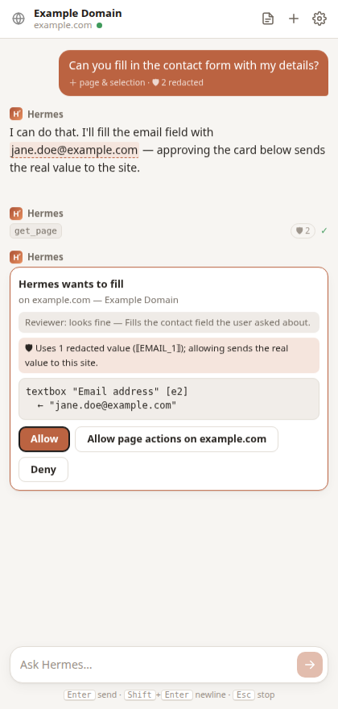
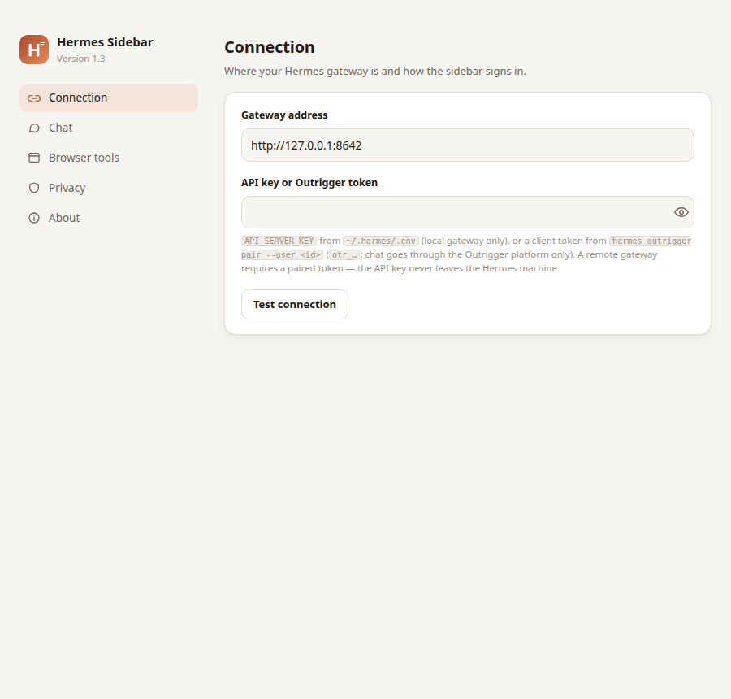

# Hermes Sidebar

Ask Hermes about the page you're reading — a browser sidebar for **Chrome/Chromium and
Firefox**, built from one shared codebase, that connects to your
[Hermes](https://hermes-agent.nousresearch.com) gateway: chat with page context,
approval-gated browser tools, client-side PII redaction, and notes on the Hermes host.

[](https://github.com/codepilots/hermes-sidebar/actions/workflows/ci.yml)
[](https://github.com/codepilots/hermes-sidebar/actions/workflows/docs-audit.yml)

| Chat with an approval card | Settings |
|---|---|
|  |  |

*Screenshots show the real UI with demo content: the 🛡 tag marks values hidden from
Hermes, and the card asks before a redacted value is sent to a site.*

## Install

Build once (Node 18+): `node build.mjs` — outputs `dist/chrome` and `dist/firefox`.

### Chrome / Chromium

1. Open `chrome://extensions`, turn on **Developer mode**.
2. **Load unpacked** → select `dist/chrome`.
3. Click the Hermes toolbar icon (or Alt+H) to open the side panel, then the gear icon
   for settings. Paste your Hermes `API_SERVER_KEY` (from `~/.hermes/.env` on the
   gateway machine). The endpoint defaults to `http://127.0.0.1:8642`.

### Firefox

1. Open `about:debugging#/runtime/this-firefox`.
2. **Load Temporary Add-on…** → select `dist/firefox/manifest.json`.
3. Open the sidebar (toolbar button or Alt+H) and set the key in settings as above.

Temporary add-ons are removed when Firefox restarts — reload after a restart. The
Firefox build is Manifest V2; see the [detailed manual](shared/README.md) for the
platform differences (no CDP: `run_js` takes an expression or IIFE, `dev_watch` uses an
injected hook).

### Connecting to a remote gateway

A remote endpoint **requires a paired client token**: on the gateway machine run
`hermes outrigger pair --user <id>` and paste the `otr_…` token instead of the API key.
The API key is accepted only for loopback endpoints (`127.0.0.1`, `localhost`, `::1`),
so the owner credential stays on the Hermes machine. Prefer `https://`/`wss://` for
remote endpoints — plain `ws://` is unencrypted.

Browser tools and platform chat (slash commands, `/model`, interactive prompts) need
the [hermes-outrigger](https://github.com/codepilots/hermes-outrigger) plugin enabled on
the gateway. Plain chat works with the API key alone.

## What you get

- **Ask about the page** — your selection (or the page text, when tools are off) is
  attached to questions, once per conversation; Hermes sees the active tab's title/URL.
- **Browser tools with approval** — read pages, snapshot with element refs, click, fill,
  open URLs, run JS, watch console/network, search history/bookmarks (opt-in
  permissions). Confirm-tools show an Allow/Deny card; you can grant a class of actions
  per site for the conversation. Hermes's reviewer may auto-approve page actions and
  navigation only (a setting); running code always asks.
- **PII redaction before anything leaves the browser** — emails, phones, cards, IPs
  (WASM detector), names, secrets, IBANs, ID numbers and semantic form fields become
  placeholders like `⟦EMAIL_1⟧`; the value map never leaves. Hermes can ask for real
  values (`reveal`) and you approve each one. Per-category switches and a site skip list.
- **Notebook mode** — Markdown notes on the Hermes host with `//` commands, preview,
  and attributed, locked edits during a turn.
- **Platform chat** — Hermes's messaging pipeline in the sidebar: slash commands with
  autocomplete, interactive prompts, images and files.
- **Conversation memory** — kept in `chrome.storage.session` (memory only, cleared when
  the browser closes).

## Privacy & security

Personal data is redacted client-side; tool calls are approval-gated; model output is
sanitized before it reaches the DOM; the extension strips `Origin` only on its own
requests to the configured gateway. The audit map — trust boundaries, controls, sinks,
and workflow diagrams — is in **[AUDIT.md](AUDIT.md)**. The dated security review and
the runtime-verification record (Firefox 158, Chromium 159) are in
[shared/docs/security-review.md](shared/docs/security-review.md).

Redaction is best effort: unusual formats and names can slip through, and Hermes's own
server-side tools see pages unredacted.

## Build, test, layout

```
node build.mjs                                    # build both browsers into dist/
node --test tests/tool-gate.test.mjs tests/outrigger-policy.test.mjs
```

- `shared/` — all browser-agnostic code (single source), plus the
  [detailed manual](shared/README.md) and docs.
- `chrome/`, `firefox/` — only the manifest and the platform adapter per browser.
- `tests/` — the approval-decision matrix and the credential/identity policy tests.
- `scripts/audit_anchor_check.py` — the docs-freshness gate run by CI.
- `dist/` — build output (gitignored).

CI requires the `test` and `docs-audit` checks on every PR: the unit suite, AUDIT.md
anchor freshness, mermaid rendering, hub pointers in every security module, and an
overclaim-word check on the shipping docs. See [AGENTS.md](AGENTS.md) for the rules.

## License

MIT — see [LICENSE](shared/LICENSE). Bundled third-party code keeps its own licences
(`shared/vendor/LICENSE.*`; settings → About lists them with versions and full texts).
